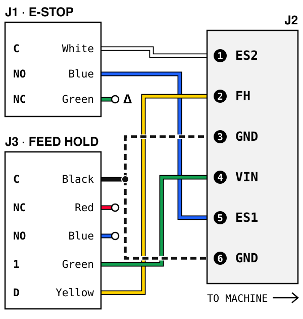

# Shapeoko 5 Pro

- **Machine:** Shapeoko 5 Pro with the 65 mm VFD spindle, the CNC station's machine.
- **Console PC:** `cnc-station-02`, running Carbide Motion. The Shapeoko shows up as
  `/dev/ttyACM0` and the jog pendant as `/dev/ttyACM1`.
- **Manuals:** [Carbide 3D docs](https://docs.carbide3d.com/) and
  [troubleshooting homing](https://qr.carbide3d.com/error/hm009).

Unlike the other files here, the wiring below is not from a maker's manual. We found no
published pinout, so it was traced at the machine with a meter on 2026-10-30.

## Resume here: the relay is good, the fault is upstream (2026-11-06)

Forced relay test run 2026-11-06 12:30 to 12:52 by Ryken Aston with Jared at the machine. The
11-04 reseat and Initialize retry had failed with the same HM009.

- Cable S5-W-IPW unplugged at the power board end, so the test used the power board's own header,
  J3 (beside relay K2 and R8). Header map, J3 label at top and K2 at bottom: left column GND, GND,
  VCC, VCC; right column RELAY_OUT, RELAY_OUT, RELAY_IN, GND.
- VCC to GND, power off, continuity mode: flashes 250 to 300 then OL as the supply capacitors
  charge. No short.
- Jumper VCC to RELAY_IN (third row), power on: the Mean Well LED is lit and the relay clicks once the
  jumper makes firm contact. The first try was silent because the jumper wasn't touching.
- RELAY_OUT to GND, DC volts, relay held: 24V.

Result: the relay and the power board work. When RELAY_IN gets 24V, RELAY_OUT delivers 24V. So the
fault is upstream: in normal operation nothing drives RELAY_IN, and that signal comes from the
Warthog over the S5-W-IPW cable. Next test: cable reconnected at both ends, e-stop released, read
RELAY_IN to GND at power-up and during Initialize. Expect 0V, which puts the fault on the Warthog
(its enable output, or the E-stop and 14V VIN logic that gates it). That makes it a warranty claim
for the Warthog to support@carbide3d.com, order #153044, not for the power board.

## Power pendant wiring

**J1, E-stop, 3 wire**

| Wire | Terminal | Signal |
|---|---|---|
| White | C | ES2 |
| Blue | NO | ES1 |
| Green | NC | marked Δ |

**J3, feed hold, 5 wire**

| Wire | Terminal | Signal |
|---|---|---|
| Black | C | GND |
| Red | NC | |
| Blue | NO | |
| Green | 1 | VIN |
| Yellow | D | FH |

**J2, 6 wire, pendant back to the machine.** Positions count top to bottom, left to right,
facing the "POWER PENDANT" inside labeling.

| Position | Signal |
|---|---|
| 1 | ES2 |
| 2 | FH |
| 3 | GND |
| 4 | VIN |
| 5 | ES1 |
| 6 | GND |

**Still untraced:** where J1 Green goes, where J3 Red and Blue go, what terminals 1 and D
belong to, and which GND position J3 Black lands on.

## Open fault: HM009, GRBL Alarm 9 (2026-10-30)

The machine connects, then homing fails about 10 seconds in. The gantry LEDs stay off and
the axes do not move. Carbide Motion's log shows `Pn:PH` (probe and feed hold inputs both
active) with the Z count reaching 232.5.

| Check | Reading |
|---|---|
| J1 White to Green | Closed in both button positions: the E-stop is stuck latched |
| J3 Black to Red | Closed released: the switch works |
| J3 Black to Blue | Closed pressed: the switch works |
| J3 Green or Yellow to those contacts | No continuity in either position |
| J1 White to Blue (J2 position 1 to 5) | Not yet metered in both positions |

**Cause (2026-10-30):** the E-stop will not mechanically release, so it is latched pressed.
Replacement: Gebildet 22 mm 2NO 2NC latching E-stop, 6 blade terminals, Amazon B094FBG1MB.

**Fitting the replacement:** do not copy the old terminal labels across. Wire ES1 and ES2 to
one pole so that J2 position 1 to 5 reads closed released and open pressed, confirm that with
a meter before power, then confirm pressing the button stops the machine.

**Log reading, 2026-11-02 (journal on `cnc-station-02`, after both switches were reworked).** Alarm 9 is unchanged: Z counts to 232.5, X and Y stay at 0. Feed hold is not the cause. The first homing attempt on 10-30 (08:16) and today's (12:44) both failed with `Pn:P` alone, no H. `P` was absent at idle through 10-29, appeared at the 10-30 power-up and has been on in every status line since. H first appeared 10-30 08:27, in the same stretch the pendant was being traced, and has toggled in and out today, so the FH line reaches the controller.

Inference, not metered: a stuck `P`, no motion and dark gantry LEDs share one cause, the E-stop loop or the rail it switches still being dead. H reads active when the FH line is open (10-30 timing), which would make FH fail-safe: released must hold it closed. J3 Black is GND and terminal 1 is VIN, so tying common to 1 shorts VIN to GND through a closed contact. No `$14` or other settings appear in the journal, so the polarity is not read from firmware.

**Traced 2026-11-02, supersedes the J3 table above.** Continuity to J2, power off: J3 Black = position 2 (FH). J3 Yellow = positions 3 and 6 (GND). J3 Green = position 4 (VIN). J3 Blue = positions 3 and 6 (GND). J3 Red = nothing. J1 White = position 1 (ES2). Terminals 1 and D are probably the button backlight (inference). Feed hold wiring: Black on C, Blue on NO, Green and Yellow on 1 and D, Red spare. The ES1 connector at J2 position 5 was loose and intermittently open; Jared tightened it 11-02, and positions 1 to 5 now read closed released, open pressed. The loop reads 0 V closed and 3.3 V open, so it is a low-voltage signal. VIN read 13.9 to 14.7 V and did not change with the E-stop; correct level unknown.

After that fix the fault remained: Main Power and Machine On lit, front C logo lit, gantry LEDs dark, X and Y slide freely, `Pn:P` steady. The USB link to the station has not dropped since 10-30 10:02 through several machine power-offs, so the controller stays alive on USB and can connect and count Z with the motors unpowered (inference).

**Traps:**
- Do not jumper ES1 to ES2 or bypass the E-stop to test or to run. Mains work and the
  interlock are Mr. Reasy's alone.
- Do not unlock past the alarm with `$X` to run a job. An unhomed machine has no reference.
- J3 Green and Yellow showing no continuity to the contacts is not by itself a fault.

**Step 14, 2026-11-02 16:00.** Initialize produced no motion at all. Going into the control box. Carbide publishes no teardown; the forum knows only that the board is called the Warthog, with an ESP32, a 328p running Grbl, and a reported 24V 2.6A fuse on the AUX port. Correction: USB did drop today at 15:45 and 16:01, both during our reseating and unplugging, so the "never dropped" note holds only through 15:44. The Carbide 5.1 Pro assembly guide is in Drive at My Drive/IC/CNC Station 2026 (id 1YfQRNmvPAUUoKE_ugUIEqYutmEx_A7u5); it warns that pushing the gantry fast back-feeds the board, and the red controller LED lighting while moved by hand is the sign. Warranty: 18 months, excludes damage from repairs tried outside Carbide, void on modifying electronics. Purchase date not on file.

**Control box opened, 2026-11-02 16:07.** The machine is a Shapeoko 5.1 Pro (Carbide order #153044, in hand by 8/17/2026; Y-right limit switch replaced under that ticket), so the earlier "5 Pro" label and the "5.1 manual differs" worry are wrong. Warranty 18 months, to about Feb 2028; 60-day guarantee ended about 10/16. Inside: Warthog v2.2a (dated 08-26-24), ESP32-S2-SOLO-2, ATmega328 (grbl silkscreen, inferred from ICSP header), H11L1 optocouplers, on-board 24V to 5V buck, motor drivers on the hidden face. Stock supply is a Mean Well RSP-200-24 (24V, 8.4A), not 48V. Carbide PCB Comb v2.0 (5/29/25) carries the terminals, BLX-A fuse holder (fuse tested good), J3 8-pin (VCC VCC GND GND, to Warthog J2), CIT J115F11A24VDCS6.9 relay (24V coil) and red disc R8. J3 carries only power, so the relay probably has no E-stop link (inference); step 12 "no click" may be normal. Lead suspect: D16, scorched pad and lifted solder mask at one end, D17 clean; marking partly hidden, ends 24A, likely a 24V TVS clamp (inference). Whether 14V VIN is abnormal has no healthy baseline. Do not reflow or remove while under warranty. Test issued: diode mode across D16 and D17 with J2 unplugged and mains off. Photos: Drive, IC/CNC Station 2026/07 Controller Teardown 2026-11-02 (folder 1tTai1N0pYn9qHglY86WqCsu-LpCyXpOt). Page: https://notes.aaand.space/shapeoko-controller-teardown.html

**D16 and D17, 2026-11-02 16:19.** Diode mode: D16 .824 and .268. D17 matches, per Jared (his text said "D18", taken as D16). Reading the same on a clean part means the meter cannot single out D16; the scorch is unproven as the cause. Whether the 8-pin was off during the reading and whether .268 held steady were not confirmed. Next: mains on, 8-pin off, USB out, read 24V at the free plug and note the supply LED.

**Supply test, 2026-11-02 16:26.** Mains on, 8-pin off: Mean Well green LED steady, 24V VCC to GND at the free plug. Cable S5-W-IPW, 8-pin labeled VCC, VCC, GND, GND, GND, RELAY IN, RELAY OUT, RELAY OUT. This corrects the earlier note: J3 is not power only, and the relay does connect to the Warthog. "No click may be normal" is withdrawn; no click is the lead clue. Inference: motors and gantry LEDs get power through the relay, and the relay never closes. Next: ohms with mains off at the free plug, RELAY IN and RELAY OUT each to VCC and to GND.

**Relay ohms, 2026-11-02 16:35.** Free plug, mains off: RELAY IN to VCC 1.3k, RELAY IN to GND 636, RELAY OUT to VCC OL, RELAY OUT to GND OL. Inference: coil about 636 ohms from RELAY IN to GND, with about 660 ohms VCC to GND through the supply; contacts open at rest. Open question: 24V relay needs about 18V to pull in, and VIN read 14V; link untraced. Next: VCC to RELAY IN jumper at the free plug, mains on, 8-pin off, listen for click, read RELAY OUT to GND.
