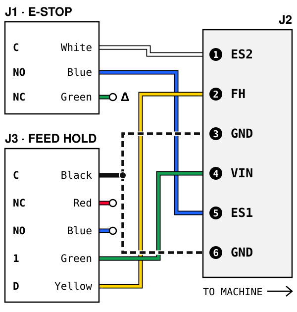

# Shapeoko 5 Pro

- **Machine:** Shapeoko 5 Pro with the 65 mm VFD spindle, the CNC station's machine.
- **Console PC:** `cnc-station-02`, running Carbide Motion. The Shapeoko shows up as
  `/dev/ttyACM0` and the jog pendant as `/dev/ttyACM1`.
- **Manuals:** [Carbide 3D docs](https://docs.carbide3d.com/) and
  [troubleshooting homing](https://qr.carbide3d.com/error/hm009).

Unlike the other files here, the wiring below is not from a maker's manual. We found no
published pinout, so it was traced at the machine with a meter on 2026-10-30.

## Power pendant wiring

**J1, E-stop, 3 wire**

| Wire | Terminal | Signal |
|---|---|---|
| White | C | ES2 |
| Blue | NO | ES1 |
| Green | NC | marked Δ |

**J3, feed hold, 5 wire**

| Wire | Terminal | Signal |
|---|---|---|
| Black | C | GND |
| Red | NC | |
| Blue | NO | |
| Green | 1 | VIN |
| Yellow | D | FH |

**J2, 6 wire, pendant back to the machine.** Positions count top to bottom, left to right,
facing the "POWER PENDANT" inside labeling.

| Position | Signal |
|---|---|
| 1 | ES2 |
| 2 | FH |
| 3 | GND |
| 4 | VIN |
| 5 | ES1 |
| 6 | GND |

**Still untraced:** where J1 Green goes, where J3 Red and Blue go, what terminals 1 and D
belong to, and which GND position J3 Black lands on.

## Open fault: HM009, GRBL Alarm 9 (2026-10-30)

The machine connects, then homing fails about 10 seconds in. The gantry LEDs stay off and
the axes do not move. Carbide Motion's log shows `Pn:PH` (probe and feed hold inputs both
active) with the Z count reaching 232.5.

| Check | Reading |
|---|---|
| J1 White to Green | Closed released and closed pressed: the E-stop does not change state |
| J3 Black to Red | Closed released: the switch works |
| J3 Black to Blue | Closed pressed: the switch works |
| J3 Green or Yellow to those contacts | No continuity in either position |
| J1 White to Blue (J2 position 1 to 5) | Not yet metered in both positions |

**Traps:**
- Do not jumper ES1 to ES2 or bypass the E-stop to test or to run. Mains work and the
  interlock are Mr. Reasy's alone.
- Do not unlock past the alarm with `$X` to run a job. An unhomed machine has no reference.
- J3 Green and Yellow showing no continuity to the contacts is not by itself a fault.
